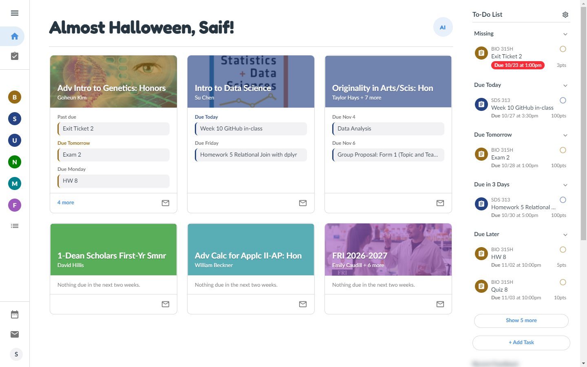
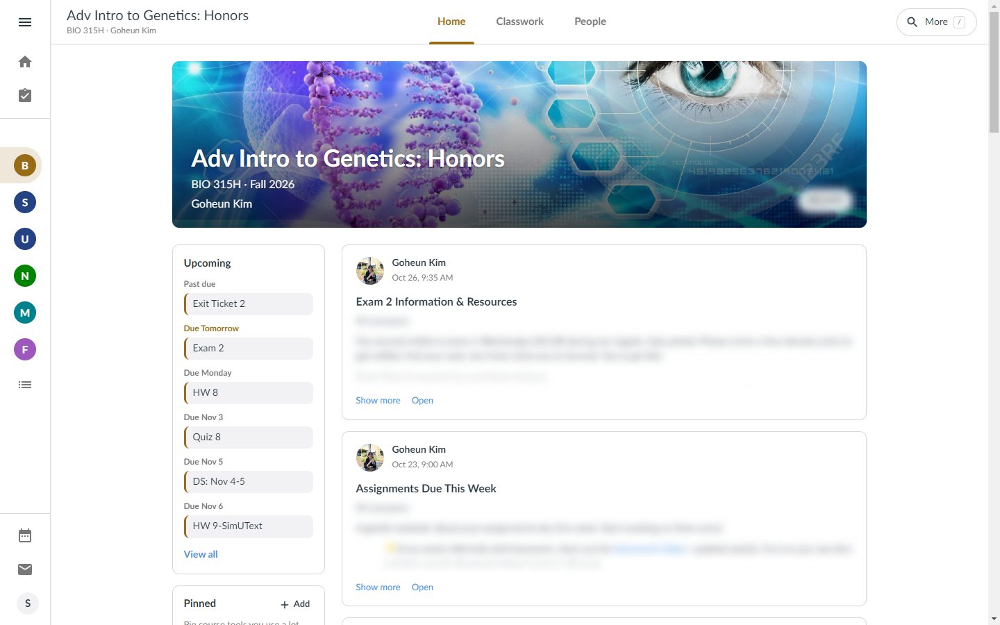
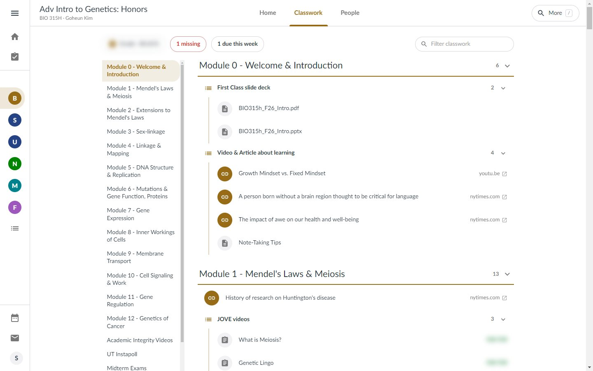
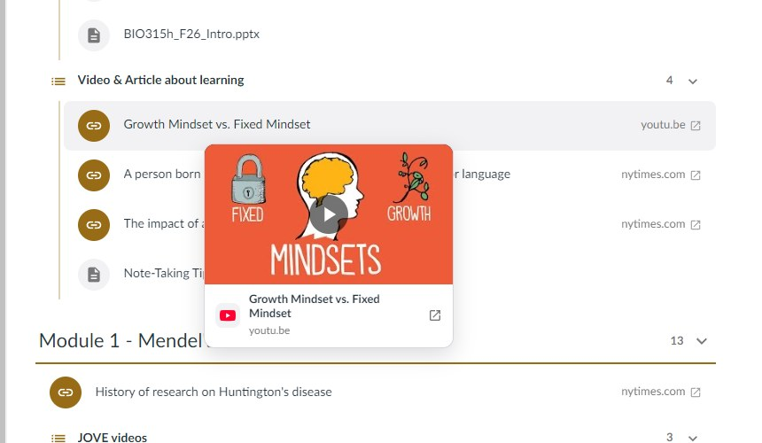
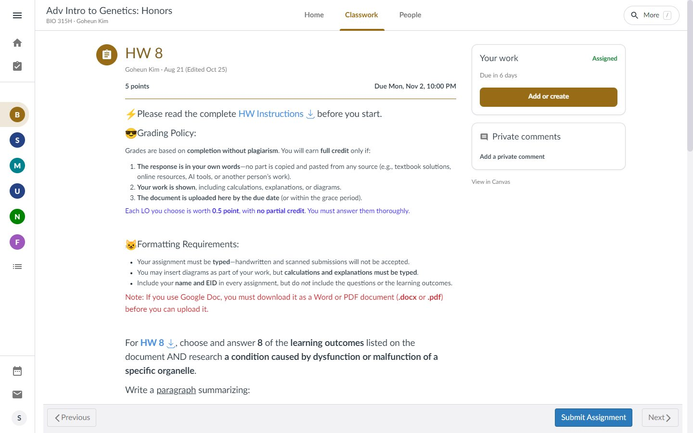
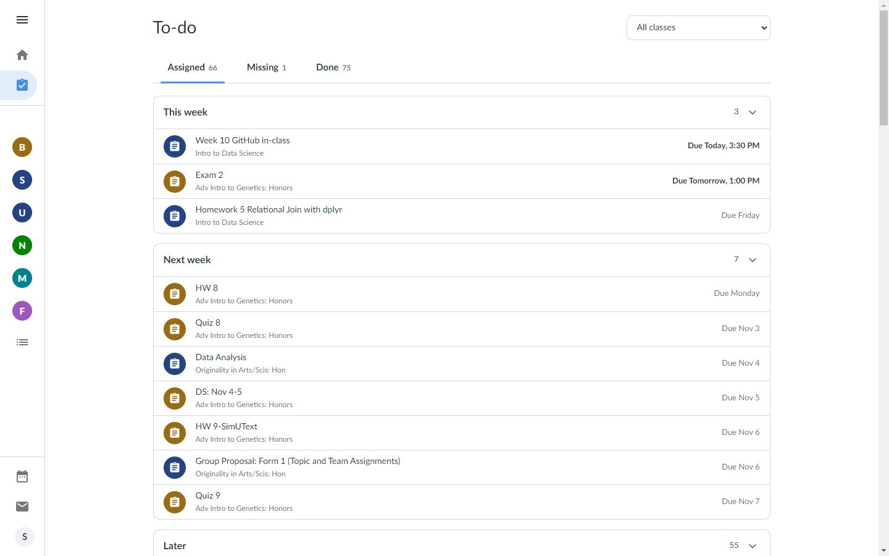
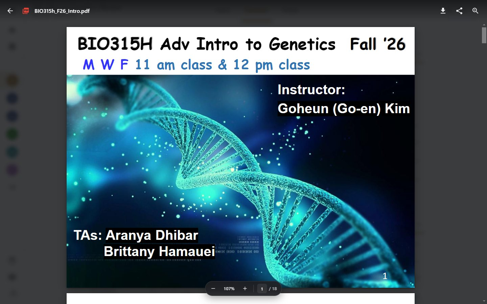
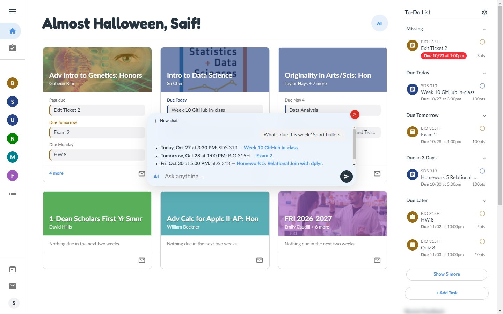
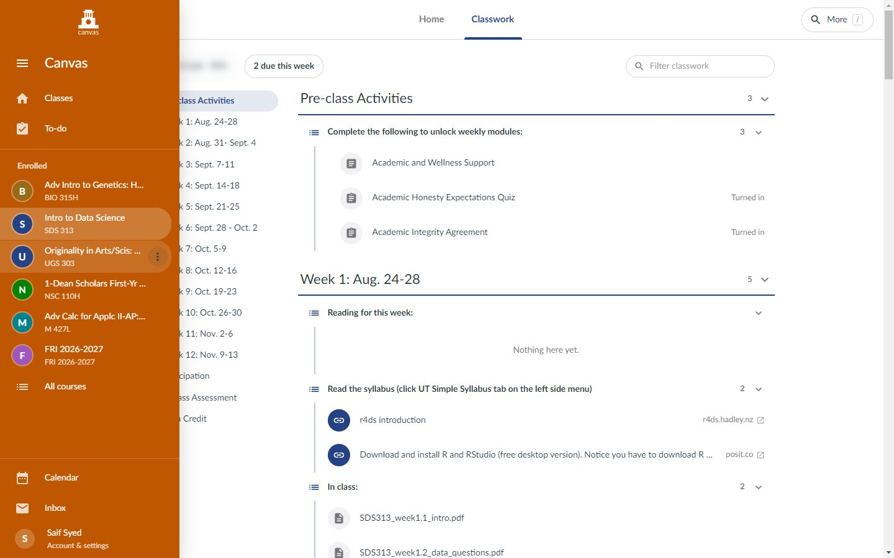
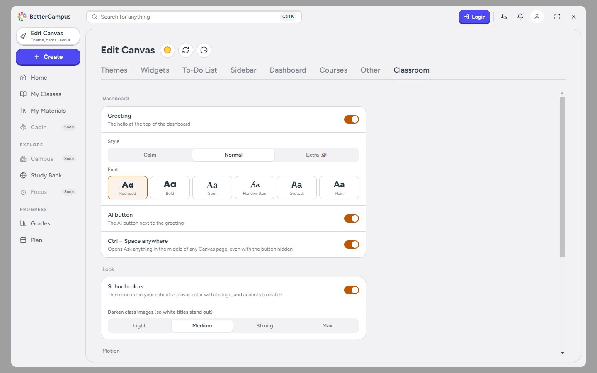

# Canvas Classroom

**Canvas, but it feels like Google Classroom, and then some.**

A Chrome extension that rebuilds Canvas around how you actually use it: a slim rail of your classes,
Home / Classwork / People on every course, one To-do list for everything, files that open in place, an AI
that has read your classes, and a little pet that lives at the bottom of the page. Pages open instantly from
cache and slide into each other instead of flashing white.

It runs on top of [BetterCampus](https://chromewebstore.google.com/detail/cndibmoanboadcifjkjbdpjgfedanolh),
so keep that installed: it still supplies its to-do sidebar, themes and dark mode.



> Screenshots are from a real UT Austin account; grades and announcement text are blurred.

## Highlights

- **Feels like Classroom.** Class cards, a stream, Classwork by topic, Classroom-style assignment and People
  pages, with Canvas's clutter tucked into one searchable **More** panel.
- **Instant.** Every page draws last visit's copy at once and refreshes quietly in the background. Tabs load
  ahead when you hover them.
- **Ask anything.** Press **Ctrl + Space** anywhere and ask about your grades, deadlines, files or feedback.
  It reads your Canvas to answer and links what it cites.
- **AI replies in the Inbox.** Start a reply and gray text suggests the rest. Press **Tab** to take it.
- **Pets.** Pick one of 3,600+ pixel pets from codex-pets.net, import your own, or have AI draw one
  (your school's mascot, say). It wanders the page,
  naps, reacts to what you do, and can be picked up and thrown.
- **Make it yours.** Themes and school colors, illustrated and moving class covers (or AI-made ones), card
  icons and colors, shortcuts, seasonal confetti when you turn something in.
- **Smooth.** Cards grow into the class banner, rows grow into the assignment, tabs slide, dark mode
  crossfades. One switch turns all of it off.

## Dashboard

- **A greeting that knows what's going on**: "Boo! Greetings, Saif!", "Happy Friday, Saif!",
  "Exam 2 is due today, Saif." It's picked from the time of day, weekday, season, holidays, how long you've
  been away and what's due soon, and it stays the same for the session. Pick its tone (Calm, Normal, or
  Extra with emoji) and font in settings.
- **Class cards** with the course name and instructor over the image, then the next two weeks of work
  grouped under "Missing", "Due 3 PM" (anything due within 12 hours shows its time), "Due Friday", three at a
  time. Each card has an email-the-instructor button, and its **⋮** menu adds shortcuts to any of the class's
  pages next to it, or hides the card (with undo, and a way back from settings).
  The streak, the progress ring, the Day/Week/Month picker, BetterCampus's premium Sync button and its
  Announcements/Completed tabs are gone.
- **To-do sidebar** restyled like Google Classroom's (overdue work keeps its red pill), cut off at two
  weeks, six items before "Show more", with Add Task, Recent Feedback and View Grades below.
- **Left rail**: Classes, To-do, then each class, with Calendar, Inbox and Account at the bottom. Hover to
  expand it, or pin it open with the menu button. Hover a class and click ⋮ to give it an icon and color.

## Course pages

The course menu becomes a top bar with **Home**, **Classwork** and **People**. Every other tool (Syllabus,
Zoom, Course Evaluations, NameCoach, Lectures Online, ...) is in **More**: click it or press `/`, type,
Enter. It also finds assignments, quizzes, pages and files across your classes: type "hw 7" and pick
"HW 7 · BIO 315H", or a file name to open it in place.



**Home** has the banner (name, instructor, grade), an Upcoming panel (missing work from the last two weeks
plus the next two weeks), a **Pinned** panel where **+ Add** pins any course tool (Instapoll, the original
home page, ...) or any link, and the stream: announcements, plus Classroom-style posts like "Su Chen posted
a new assignment: HW 5" and "posted 3 new materials" (file chips open in place) from the last three weeks.
Past the first two, items fade and slide up as you scroll to them.



**Classwork** shows modules as topics, each item with its grade, "Turned in", "Missing" or due date.
A module's text headers become collapsible subgroups, assignments outside any module are listed by group,
and the course's files sit at the bottom as type tiles, grouped by folder. There's a grade chip and a filter
box, and what you open or close is remembered per class. Assignments open right there on Classwork. Web links
open in a new tab, and hovering one shows a preview by the cursor (title, site and favicon, with the
thumbnail for YouTube):



**People** is laid out like Classroom's: Teachers (with TAs), your groups, then Classmates with a count.
Click anyone for a compact card with their bio, email when Canvas shares it, a Message button, and the
classes you share with them.

The original Canvas pages are still reachable from More (or add `?gcx-original=1` to a URL).

### Class covers

Give any class a cover from the banner: illustrated ones (Library, Math, Seminar, Geography, Econ), color
ones (Aurora, Ocean, Blueprint, Dots, Sunset, Forest, Peach, Dusk), some of which drift slowly, your own
image, or one generated by AI from the class name. Covers show on the dashboard cards too, under the course
color wash.

## Assignments

Assignment pages look like Classroom's: the title with a course-colored icon, instructor and date, points
and due date, the instructions, attached files (they open in the viewer) and the rubric on the left. On the
right, a **Your work** card shows the status (Assigned, Turned in, Missing, a score, Excused...) and lets you
turn in text, a link or files, with your past attempts and private comments in the same panel. Canvas still
does the actual submitting; "View in Canvas" shows the stock page.



## To-do

Every class's work in **Assigned / Missing / Done**, with a class filter. It opens instantly from cache and
refreshes in the background.



## Files open in place

Clicking a course file opens it over the page instead of leaving it: PDFs render with zoom and a page
counter, slides and documents use Canvas's own viewer. Back, download, share and zoom are in the top bar, and
a details panel shows who uploaded it, when, its size, type, folder and class. Esc or browser Back closes
it. Ctrl/Cmd-click still opens the normal page.



## Ask anything

The **AI** button next to the greeting rolls open into a pill on hover; click and type, and it grows into a
chat. Or press **Ctrl + Space** on any regular Canvas page: the page blurs and a wide "Ask anything" pill
opens in the middle (or wherever you last left it). Drag it anywhere; once you ask, the blur clears and it
becomes the chat right where you left it. **Ctrl + Shift + Space** brings back your last conversation, full
size and without the blur, even on another page; drag its corner to resize it. Esc or Ctrl + Space closes
it, so does moving the pointer well away from it before you've asked anything, and so does the red X once
it's a chat.

It answers from your Canvas (courses, assignments, grades, feedback, modules, files including PDFs, slides
and docs, announcements, quizzes, discussions, pages, the syllabus, people and the inbox) and links what it
cites. Ask it to "take me to my Genetics grades" and it opens the page. It only reads and navigates; it never
submits, posts or changes anything. Quick lookups go to a smaller, cheaper model and anything that needs
reading, explaining or planning goes to the full one (settings can turn that off).



## Inbox suggestions

Reply to a message in Canvas's Inbox and gray text appears after the cursor with a suggested reply, written
from the conversation and in your voice. Start typing and it keeps up: it finishes the word you're on or the
sentence you started.

| Key | Does |
| --- | --- |
| **Tab** | take the whole suggestion |
| **Ctrl + →** | take the next word |
| **Esc** | hide it |

Typing what it suggests uses it up as you go. It works on new messages too, once you've written a few
words. The conversation and your draft go to OpenAI to write it; turn it off in settings with
"Suggestions in Inbox".

## Pets

Turn on a pet in settings and it lives along the bottom of every Canvas page, keeping its spot from page
to page.

- **3,600+ to pick from**, searchable, from [codex-pets.net](https://codex-pets.net), most popular first.
- **Make your own with AI**: describe it ("a frog in a graduation cap") or tap **My school's mascot**,
  and it draws the character in six poses and turns them into a full animated pet in about half a
  minute (uses your OpenAI key).
- **Bring your own**: Import a codex-pets.net `.zip`, a `pet.json` with its spritesheet, a bare
  spritesheet, or drop a whole pet folder (like the ones in `~/.codex/pets`) on the picker.
- **It has a life**: it wanders, looks around, hops when it's happy, and gets curious ("?") when you type.
  Put it on a class card and now and then it walks to the edge, thinks it over, backs up for a run-up and
  leaps across to another card, skidding to a stop with a little burst of stars.
  When the AI is thinking it runs along with it and waves when the answer lands. Leave it alone and it yawns,
  dozes off with z's and a quiet snore, and wakes when you come back.
- **Pick it up**: drag it, throw it, and it squishes on landing, bonks off the edges, and dusts up little
  clouds as it runs.
- **Sound, if you want it**: soft footsteps, a thud when it lands, a whoosh when you throw it, a chirp when
  you pat it, with its own volume slider. Off by default.

Sprites are shrunk to their on-screen size with a sharpening pass, so the pixel art stays crisp at any size
and zoom. Pet, size, roaming (and how much it walks) and sound are in settings.

## Themes and school colors

Pick a theme in settings and the rail and accents take its color: Deep blue, Forest, Plum, Crimson, Teal or
Slate. **School** uses your school's own Canvas branding instead: its color and logo on the rail, with its
wordmark above the to-do list.



## Settings

Settings are a **Classroom** tab inside BetterCampus's settings (its gear, top right of the to-do list), or
open them from the palette button in any course's top bar. Like BetterCampus's own tabs, it keeps the live
dashboard preview beside it, so you see each change as you make it:

- greeting on or off, tone and font, and how much room there is between the menu rail and your classes
- the AI button and the Ctrl + Space shortcut, separately; the quick model for simple questions; Inbox
  suggestions
- the theme (Default, School, Deep blue, Forest, Plum, Crimson, Teal, Slate), a course-color wash over class
  images and how strong it is, black-and-white or dimmed images, and how dark class images get behind their
  white titles
- pets: which one, size, roaming and how much it walks, sound and its volume
- page animations, the click ripple on class cards, and announcements easing in as you scroll
- confetti when you submit something, which goes seasonal around Halloween, Thanksgiving, Christmas,
  New Year, Valentine's, St. Patrick's and the Fourth



## Motion

Opening a class grows its card into the banner, and opening an assignment grows its row into the page. Pages
slide between a course's tabs (the tab underline slides with them), class pieces ease in one by one while the
course name crossfades in the top bar, sections expand and collapse smoothly, loaded content fades in over
shimmer placeholders, a course-colored loading bar runs along the top, and switching BetterCampus between
dark and light mode crossfades. Esc goes back. Background refreshes update in place without replaying any of
it. It all turns off with "Page animations" in settings or the OS "reduce motion" setting.

## Keyboard

| Key | Does |
| --- | --- |
| **Ctrl + Space** | Ask anything, on any Canvas page |
| **Ctrl + Shift + Space** | bring back the last chat |
| **/** | search More: course tools, assignments, files |
| **Esc** | close the viewer, chat or panel; go back from a class |
| **Tab** / **Ctrl + →** | take an Inbox suggestion / one word of it |

## Install

1. Install [BetterCampus](https://chromewebstore.google.com/detail/cndibmoanboadcifjkjbdpjgfedanolh) from the
   Chrome Web Store.
2. Open `chrome://extensions` and turn on **Developer mode**.
3. Click **Load unpacked** and pick this folder.
4. Reload any open Canvas tab.

After editing the code, hit the reload icon on the extension's card in `chrome://extensions`, then refresh
Canvas.

### OpenAI key for the AI features

Ask anything, Inbox suggestions, AI covers and AI pets need an OpenAI key. Click **Add key** in the chat (or Details →
Extension options on the extension's card) and paste it. It's kept in the extension's storage and only the
extension's background worker sends it, to api.openai.com; it's never typed into or handed to the Canvas
page. For development you can instead put it in a git-ignored `config.local.json` next to `manifest.json`,
which is used when no key is saved:

```json
{ "openaiKey": "sk-..." }
```

### Bundling your own pets

Pets listed in a git-ignored `pets.local/index.json` (an array of folder names, each with a `pet.json` and
its spritesheet) are imported the first time the pet picker opens, so they're there after a fresh Load
unpacked.

## Notes

- It runs on `*.instructure.com` pages and uses Canvas's own API with your session. Questions you ask
  (with your course list and the Canvas data the assistant looks up), Inbox messages you write with
  suggestions on (and the thread you're replying to), AI cover and AI pet requests (and, for "My school's
  mascot", your Canvas address) go to OpenAI. See the
  [privacy policy](docs/privacy.md).
- Assignments, Classwork, files and announcements are cached in the extension's storage, per Canvas site
  and per user, and dropped after 30 days without a refresh. Pages draw the cached copy at once, refresh in
  the background (Classwork and To-do show "Updating" while they do), and redraw only if something changed.
  Opening any page of a class warms its Classwork cache. Smaller things (course names, colors, rail icons,
  pinned links) live in `localStorage` under `gcx:`.
- BetterCampus's two-week range ("Custom") is a premium feature. If BetterCampus is set to Day or Week, the
  extension switches it to Month once (that setting sticks), then hides anything due more than 14 days out.
- "Missing" (red) means Canvas flagged it missing. "Past due" means the date passed with nothing handed in,
  which also covers in-class and on-paper work that hasn't been graded yet.
- Courses that hide Modules still get Classwork, served from `/courses/:id?gcx=classwork`.
- Without BetterCampus, a Settings item appears at the bottom of the rail instead of the Classroom tab.
- To turn it off, disable the extension in `chrome://extensions`. BetterCampus goes back to normal; only the
  Month setting stays.
- Fonts (Fredoka, Poppins, Playfair Display, Caveat, Space Grotesk) are bundled under the SIL Open Font
  License; see `fonts/`. PDF rendering uses Mozilla's pdf.js (Apache 2.0), bundled under `viewer/pdfjs/`.
  Pets are made by their authors on codex-pets.net.
